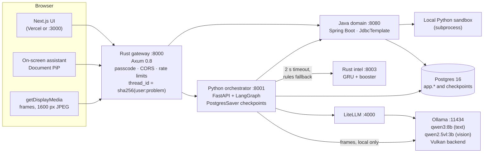
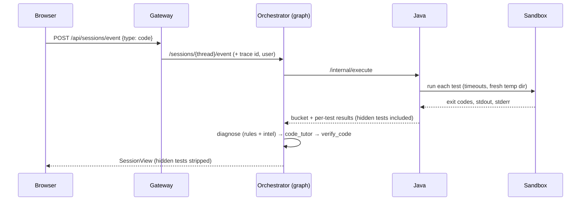
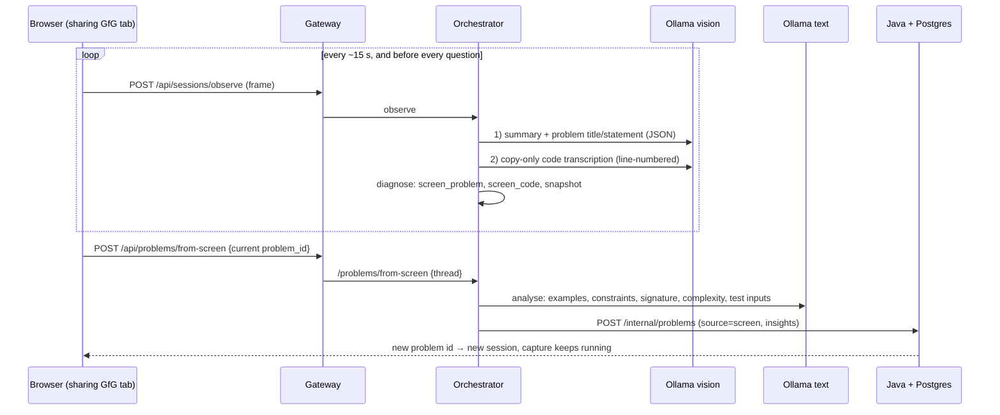
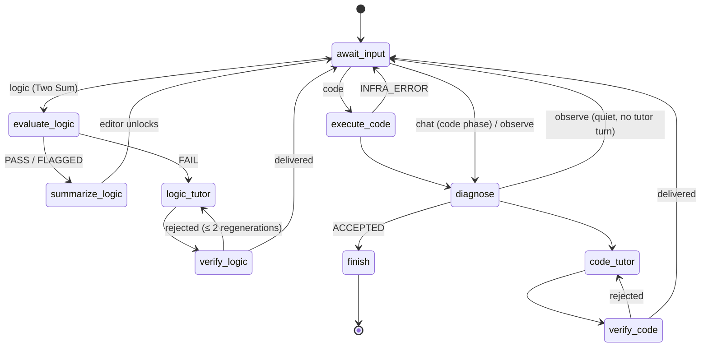
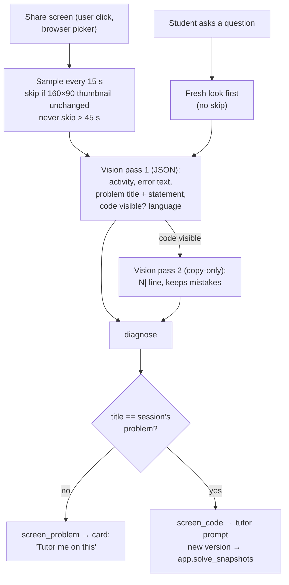
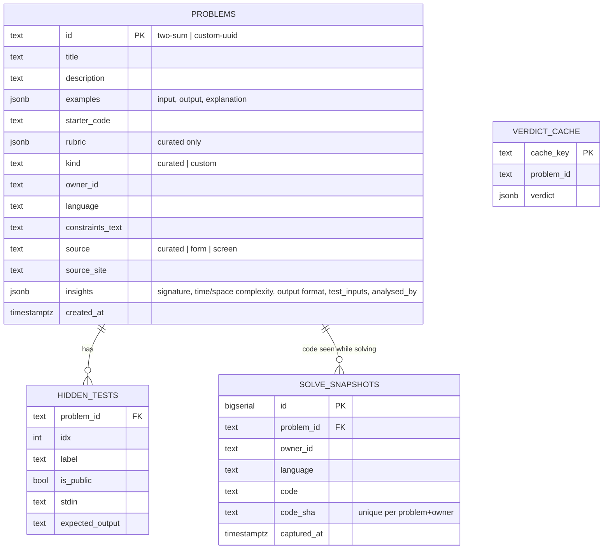

# LogiStream

**A Socratic coding tutor that makes students think before they type, and an
on-screen agent that watches them solve problems anywhere — without ever handing
over the answer.**

[](https://colab.research.google.com/github/SachmanChadhaa/Logi_Stream/blob/main/notebooks/LogiStream_GRU_XGBoost.ipynb)

LogiStream has **two parts**. Both share one tutor that is **structurally
prevented** from giving the solution: every reply is checked by a deterministic
verifier before the student sees it, and it answers with a question, not a fix.

### Part 1 — Learn logic first, then code (curated problem suite)

A Socratic tutor plus a suite of curated problems that teaches *how to think
before typing*. For each problem the student must first **describe the algorithm
in plain English or Hinglish**. An evaluator grades that logic against the
problem's rubric (valid approaches, invariants, known misconceptions); wrong
logic gets one guiding question at a time; correct logic **unlocks the code
editor**. The code then runs against hidden tests, and failures are explained in
terms of the student's *own accepted logic*.

The suite today holds one fully worked problem, **Two Sum**, with its rubric,
misconceptions and hidden tests (including a 20 000-element test that rejects an
O(n²) solution). New problems use the same seed format
(`db/seed/generate_two_sum.py` → `db/init/02_seed.sql`).

### Part 2 — Your own problem, kept in your own problem bank

When a student wants help with a problem **they chose** — typed in, or **read
off their screen** while they work on GeeksforGeeks, LeetCode or their own
editor — LogiStream helps them develop the logic and the code for it in one
free-form conversation (there is no rubric for a problem it has never seen, so
there is no gate). The problem is **stored in the database under that student**
so they can come back to it later: statement, examples, constraints, function
signature, expected time and space complexity, output format, suggested
edge-case test inputs, and every distinct version of the code they wrote while
solving it.

Behind both parts: five services, a local vision model, a local language model,
and two small machine-learning models written in Rust. Everything runs on one
laptop; screen frames never leave it.

---

## Contents

1. [What a student can do](#1-what-a-student-can-do)
2. [What is new](#2-what-is-new)
3. [Architecture](#3-architecture)
4. [How a request flows](#4-how-a-request-flows)
5. [The tutor graph (LangGraph)](#5-the-tutor-graph-langgraph)
6. [The on-screen agent, in depth](#6-the-on-screen-agent-in-depth)
7. [Data model](#7-data-model)
8. [Diagnosis and the Rust ML sidecar (GRU + XGBoost)](#8-diagnosis-and-the-rust-ml-sidecar-gru--xgboost)
9. [Honesty and safety guarantees](#9-honesty-and-safety-guarantees)
10. [Public API](#10-public-api)
11. [Running it locally](#11-running-it-locally)
12. [Testing](#12-testing)
13. [Repository layout](#13-repository-layout)
14. [Known limitations](#14-known-limitations)
15. [Future scope: fixing the GPU and vision-model issues](#15-future-scope-fixing-the-gpu-and-vision-model-issues)
16. [Project history](#16-project-history)

---

## 1. What a student can do

| Mode | How it works |
|---|---|
| **Part 1 — curated problem (Two Sum)** | Logic-first gate. Write the algorithm in words → an evaluator grades it against a rubric (approaches, invariants, known misconceptions) → wrong logic gets one Socratic question at a time → correct logic unlocks the editor → code runs against hidden tests → failures go to a code tutor that explains in terms of the student's *own accepted logic*. |
| **Part 2 — bring your own problem** | Paste any exercise (statement, constraints, examples, optional stdin → stdout tests). One free-form phase: chat and run any time. Runs without tests are labelled **"ran, not verified"**, never "correct". |
| **Part 2 — on-screen assistant** | An always-on-top panel (Chrome Picture-in-Picture) with a Siri-style orb. Share a window and it reads the **problem** and the **code you are writing** on any site, offers **"Tutor me on this"**, reviews your code as a *hypothesis*, suggests **test inputs worth trying**, and answers questions about the code *as it is now*. Optional voice input and read-aloud. |

Every tutor reply separates **Verified:** (what actually ran and was checked)
from **Hypothesis:** (what it suspects), and ends with a question — never a fix.

---

## 2. What is new

Compared with the original MVP (one problem, hosted Judge0, cloud LLM, light UI):

| Area | New |
|---|---|
| **Problems** | Bring-your-own-problem: create, validate (Java), own (per-browser identity), run with stdin/stdout tests; `NO_TESTS` bucket for unverified runs. |
| **On-screen agent** | Opt-in screen capture → **local** vision model (Qwen2.5-VL 3B via Ollama). Reads the visible problem *and* transcribes the student's code line by line (a dedicated copy-only pass that keeps mistakes such as duplicated lines). Frames are never stored. |
| **Screen problems in the database** | "Tutor me on this" stores the problem **in depth**: statement, examples (input / output / explanation), constraints, function signature, expected time and space complexity, output format, 4–6 suggested edge-case test inputs with reasons, and **every distinct version of the student's code** seen while solving (`app.solve_snapshots`). |
| **No repetition, no loops** | A fresh look at the screen before every question; asking again about unchanged code escalates the hint level (1 → 3); the prompt lists what was already said; the verifier rejects word-for-word repeats; `Verified:` is downgraded to `Hypothesis (not run):` when nothing has executed. |
| **Temporal memory** | Per-session memory in the LangGraph checkpoint: rolling summary, last 20 events, code revision, open hypotheses, next action, student state, GRU hidden state. Screen observations go **stale** after a newer run. |
| **Diagnosis** | Deterministic `diagnose` node: rules-v1 ranker with quoted evidence, feature schema v1 (30 numbers), at most two passes. |
| **Rust `intel/` sidecar** | A GRU (burn) for student state and an XGBoost-style booster written from scratch in Rust, cross-checked against real xgboost (99.8 % agreement). Synthetic-trained v0, advisory, **shadow mode**. Explained step by step in the [Colab notebook](notebooks/LogiStream_GRU_XGBoost.ipynb). |
| **Local LLM** | LiteLLM → local Ollama `qwen3:8b` (8k context, thinking off; fits an 8 GB GPU). OpenRouter kept only as a backup group. |
| **Public-demo guards** | Demo passcode on every `/api` call, CORS allow-list, per-passcode rate limits; Vercel UI + Cloudflare tunnel runbook. |
| **UI** | Cursor Dark theme, Lucide icons, Monaco `cursor-dark` editor theme, Siri-style animated orb, status-bar "Under the hood" panel. |
| **Removed** | The hosted **Judge0** integration (client, config, smoke script, env vars). All code runs in the local Python sandbox. |

---

## 3. Architecture



| Service | Tech | Port | Owns |
|---|---|---|---|
| `web/` | Next.js 16, React 19, Tailwind v4, Monaco, lucide-react | 3000 | UI, PiP assistant, screen capture |
| `gateway/` | Rust, Axum 0.8, reqwest | 8000 | the only public entry point; identity, thread derivation, guards |
| `orchestrator/` | Python 3.11, FastAPI, LangGraph | 8001 | tutor graph, verifier, diagnosis, observer, temporal memory |
| `domain/` | Java 17, Spring Boot 3, JdbcTemplate | 8080 | problems, tests, execution, screen-problem storage |
| `intel/` | Rust, burn 0.18, axum | 8003 | GRU student-state model, booster cause ranker |
| Postgres | 16 (Docker) | 5432 | `app` schema (Java), `orch` cache, LangGraph checkpoints |
| LiteLLM | Docker | 4000 | model routing and failover |
| Ollama | native | 11434 | local text and vision models |

**Identity.** Auth is still the MVP mock: each browser keeps a random
`anon-<uuid>` and sends it as `X-Demo-User`. The gateway derives
`thread_id = sha256(user_id + ":" + problem_id)` and **ignores any thread id a
client sends**. Custom problems are owner-checked on every read.

---

## 4. How a request flows

### Running code



### "Tutor me on this" (a problem seen on screen)



The screen text never comes from the browser request: the server takes it from
the session's own memory.

---

## 5. The tutor graph (LangGraph)



* `await_input` contains **only** `interrupt()` — LangGraph re-runs an
  interrupted node from its first line on resume, so nothing with a side effect
  may sit before it.
* The session is one long-running graph; every student action is a resume.
  Checkpoints live in Postgres, so a refresh or a server restart resumes the
  conversation exactly.
* **Verifier** (`verifier.py`, deterministic, unit-tested). Logic phase rejects
  code fences, code-like lines, rubric-forbidden terms ("hashmap", "two
  pointer", …) and replies over 120 words. Code phase rejects the entrypoint's
  definition, code blocks over 3 lines, replies over 160 words, word-for-word
  repeats of the previous reply, and turns `Verified:` into
  `Hypothesis (not run):` when nothing has executed. After two rejections a
  canned Socratic fallback is delivered; unverified text never is.
* **Fallbacks.** If the LLM is down, the code tutor delivers a deterministic hint
  built from the diagnosis, and the logic tutor delivers the rubric's own
  Socratic question — both flagged `fallback_used`.

---

## 6. The on-screen agent, in depth



* **Two vision passes.** Asked to put code inside its JSON summary, the 3B model
  "tidied" it — it silently dropped a duplicated `int max = arr[0];`, the very
  bug the tutor should see. Asked separately to pair each line with the editor's
  line number, it copies faithfully. Frames go up at 1600 px because at 1024 px
  it misread `arr[0]` as `0`.
* **Code from another site in another language** (e.g. C on GeeksforGeeks) is
  reviewed *in its own language*, quoted by line number, and always as a
  hypothesis — this app can only execute Python.
* **Staleness.** An observation records the code revision it was captured at;
  after a newer run it is shown as "seen earlier" and the prompt says not to
  treat it as current.
* **Seamless switch.** Capture and the PiP window live above the per-problem
  session, so switching problems re-points the capture instead of ending it.
* **Privacy.** Local only: `OLLAMA_URL` must be localhost or the orchestrator
  refuses to start. Frames are validated (JPEG/PNG, ≤ 2.5 MB), one VLM call at a
  time, never written to disk or the checkpoint; only short text is kept.
  Capture is visible, pausable and stops with the browser's own "Stop sharing".
* **GPU faults are named.** If the vision model answers `@@@@` (Ollama's CUDA
  backend on an RTX 5050), the observer says so and how to fix it instead of a
  parse error. `OLLAMA_VLM_NUM_GPU=0` runs vision on the CPU as an emergency
  fallback (~1–2 min per frame). See "GPU notes" in §11.

---

## 7. Data model



`db/init/` creates the base schema on an empty volume; all later columns and
tables are idempotent `ALTER … IF NOT EXISTS` statements in
`domain/src/main/resources/schema-byop.sql`, run by Spring at every start, so
an existing demo database is upgraded in place and never wiped.

---

## 8. Diagnosis and the Rust ML sidecar (GRU + XGBoost)

**Open the notebook:**
[`notebooks/LogiStream_GRU_XGBoost.ipynb`](notebooks/LogiStream_GRU_XGBoost.ipynb) ·
[**Run it in Colab**](https://colab.research.google.com/github/SachmanChadhaa/Logi_Stream/blob/main/notebooks/LogiStream_GRU_XGBoost.ipynb)
— diagrams, equations, a worked gain example, a from-scratch booster checked
against real xgboost, GRU training with truncated BPTT, confusion matrices,
hidden-state trajectories, feature importance and the shadow-mode gate.

1. **Rules first.** `diagnostics.py` ranks up to three candidate causes for a
   run (22 cause ids: `syntax`, `missing-key`, `too-slow`, `prints-nothing`,
   `logic-wrong-on-case`, …), each with quoted evidence from stderr, tests and
   the code.
2. **Feature schema v1.** Every event becomes 30 numbers in `[0, 1]`
   (`docs/feature_schema_v1.md`); Python and Rust are checked against one golden
   vector.
3. **GRU** (`intel/src/gru.rs`, burn): 30 → GRU(32) → student state (4) and
   cause group (6). Its hidden state is stored in the session checkpoint, so the
   sidecar itself is stateless.
4. **Booster** (`intel/src/booster.rs`, pure Rust): 22 one-vs-rest tree
   ensembles with second-order gradients, `w* = −G/(H+λ)`, split gain with γ,
   32-bin histograms, subsampling; input = 30 features + GRU's 4 + 6 scores.

| Held-out (synthetic) | Rules | Rust model | real xgboost |
|---|---|---|---|
| Student state accuracy | 0.637 (heuristic) | **GRU 0.921** | – |
| Cause real-choice top-1 | **0.964** | booster 0.899 | 0.900 |

The booster loses to the rules, so it runs in **shadow mode**: scores are shown,
the rules keep the order. It may reorder only if held-out metrics say it won,
and never adds a cause the rules did not find. If `intel` is down, everything
falls back to `rules-v1` within 2 s.

The Colab notebook re-implements both models in PyTorch / xgboost on its own
synthetic sessions, so its numbers differ from the Rust run above (its last
execution: GRU 0.962 vs heuristic 0.893 state accuracy; booster real-choice
top-1 0.921 vs rules 0.981, so it, too, ends in shadow mode). All of these are
synthetic-data results, not validation on real students, and the scores are
rankings, not probabilities.

---

## 9. Honesty and safety guarantees

* The tutor **never writes the solution**: enforced by the verifier, not just the
  prompt. Statements and screen text are treated as data (prompt-injection
  resistant), and the tutor is told to ignore instructions inside them.
* **Verified vs Hypothesis** is enforced: nothing is called verified unless it
  ran in the sandbox and was compared.
* ML outputs are labelled **synthetic-trained v0, advisory, unvalidated**; scores
  are never called probabilities.
* The local Python sandbox is **not a security sandbox** (timeouts, a fresh temp
  directory, no shell, `python -I`, output caps). The public path is protected
  only by the passcode, the CORS allow-list and rate limits.
* Errors shown to students never include upstream bodies (provider messages,
  account ids); full details stay in the server logs, tied together by one
  `X-Trace-Id` across every service.
* No secrets in git: everything is read from `.env` (see `.env.example`).

---

## 10. Public API

Everything the browser calls goes through the gateway. When `DEMO_PASSCODE` is
set, every `/api` call needs `X-Demo-Passcode`.

| Method | Path | Purpose |
|---|---|---|
| GET | `/health` | liveness |
| GET | `/api/auth/check` | 200, or 401 `passcode_required` |
| GET | `/api/problems` | curated samples + your own problems |
| POST | `/api/problems` | create your own problem (422 `{error, field}` on bad input) |
| POST | `/api/problems/from-screen` | `{problem_id}` → store the problem seen on screen in that session, in depth; returns `{id, reused}` |
| GET | `/api/problems/{id}` | browser-safe view (no rubric, no hidden tests), incl. `source`, `insights`, `snapshot_count` |
| POST | `/api/sessions/start` | `{problem_id}` → SessionView (resumes if it exists) |
| POST | `/api/sessions/event` | `{problem_id, type: logic \| chat \| code, text}` |
| POST | `/api/sessions/observe` | `{problem_id, image_b64, trigger, code_revision}` (3 MB cap, rate-limited) |
| POST | `/api/sessions/reset` | `{problem_id}` |
| GET | `/api/sessions/{problem_id}` | current SessionView |
| GET | `/api/observer/status` | is the local vision model ready |

The `SessionView` contract (phase, status, messages, last evaluation, last
execution with hidden tests stripped, diagnosis, temporal memory, debug trace) is
specified in the original MVP contract (§5.2, see §16) and extended additively in `docs/BYOP.md`.

---

## 11. Running it locally

**Prerequisites:** Docker Desktop, Git Bash (Windows), Node ≥ 20, Java 17 +
Maven, Rust (GNU toolchain), Python 3.11 via `uv`, and Ollama with:

```bash
ollama pull qwen3:8b
```

```bash
ollama create logistream-qwen3-8b -f ollama/Modelfile.logistream-qwen3-8b
```

```bash
ollama pull qwen2.5vl:3b
```

**GPU notes (8 GB cards, tested on an RTX 5050 laptop GPU, Ollama 0.32.7).**
Measured on 2026-10-24:

| Setup | Result |
|---|---|
| CUDA backend, `qwen2.5vl:3b` with an image | every answer `@@@@` (text-only prompts are fine) |
| CUDA backend, `qwen3-14b` (needs ~10.8 GB, split GPU+CPU) | crash: `MUL_MAT failed`, `0xc0000409` |
| Vulkan, `qwen3-14b` split | works, ~5 tok/s (tutor reply ~106 s) |
| **Vulkan, `qwen3:8b`** (6.2 GB, all on GPU) | **~23 tok/s (tutor reply ~6–30 s)** |
| **Vulkan, `qwen2.5vl:3b`** | **reads the test frame's 9 code lines exactly, ~8 s warm** |
| Vulkan, `qwen3-vl:4b` | empty answers (all output goes to "thinking"), 3–5 min a frame |

So on this machine Ollama must run on **Vulkan**. `demo/start.sh` passes
`OLLAMA_LLM_LIBRARY=vulkan` from `.env` to the `ollama serve` it starts, and
restarts one it started earlier on another backend. The Ollama tray app reads
Windows user environment variables instead; set them once and restart the app:

```bash
setx OLLAMA_LLM_LIBRARY vulkan
```

```bash
setx OLLAMA_VULKAN 1
```

On GPUs where CUDA works, leave `OLLAMA_LLM_LIBRARY` empty.

**Configure:** copy `.env.example` to `.env` and fill it in (never commit `.env`).

**Start everything** (from Git Bash; in VS Code, set the default terminal profile
to *Git Bash* first — plain `bash` in PowerShell starts WSL):

```bash
bash demo/start.sh
```

```bash
bash demo/healthcheck.sh
```

Then open **http://localhost:3000** in **Chrome** (Picture-in-Picture, screen
capture and voice are Chrome features). `start.sh` rebuilds anything whose
sources changed, trains the `intel` models on first run (~90 s), and writes logs
to `demo/logs/`.

```bash
bash demo/stop.sh
```

**Public demo** (UI on Vercel, backend on this laptop behind a Cloudflare quick
tunnel): see [`demo/DEPLOY_VERCEL.md`](demo/DEPLOY_VERCEL.md).

---

## 12. Testing

| Suite | Command | Result |
|---|---|---|
| Orchestrator (graph, verifier, observer, temporal, screen problems) | `cd orchestrator && uv run pytest` | 137 passed |
| Java (bucket mapping, validation incl. screen insights) | `cd domain && mvn test` | 24 passed |
| Gateway (passcode, CORS, rate limit, identity) | `cd gateway && cargo test` | 11 passed |
| Intel (features, GRU, booster, metrics) | `cd intel && cargo test --release` | 14 passed |
| Web | `cd web && npx tsc --noEmit && npx next build` | clean |
| End to end, Two Sum | `bash demo/rehearse.sh`, `bash gateway/verify.sh` | green |
| End to end, bring your own problem | `python -I demo/verify_byop.py` | 41 / 41 |

---

## 13. Repository layout

```
db/                     schema + Two Sum seed generator
domain/                 Java: problems, validation, execution, screen-problem storage
orchestrator/           Python: LangGraph tutor, verifier, diagnostics, observer, temporal memory
  app/nodes/            await_input, evaluate_logic, logic_tutor, summarize_logic,
                        execute_code, diagnose, code_tutor, finish
  app/screen_problems.py  in-depth analysis + storage of problems read off the screen
gateway/                Rust: the public API, identity, guards
intel/                  Rust: GRU + booster, synthetic data, training, serving
web/                    Next.js UI, on-screen assistant, screen capture
notebooks/              GRU + XGBoost explained (Colab), and its generator
demo/                   start/stop/healthcheck, rehearsal, fixtures, deploy runbook
docs/                   BYOP handoff, feature schema v1
ollama/                 Modelfile for the 8k-context tutor model
```

---

## 14. Known limitations

**Product**

* The curated suite (Part 1) has one problem, Two Sum. Adding a problem means
  writing its rubric, misconceptions and tests by hand.
* Problems from Part 2 have no rubric, so there is no logic gate and no
  evaluator verdict; the tutor reasons from the statement, the runs and the
  rules-based diagnosis.
* Only Python executes. Code in other languages (e.g. C on GeeksforGeeks) is
  reviewed as a hypothesis, never run.
* Mocked auth: identities are anonymous per browser; clearing site data loses
  access to that student's stored problems.

**Execution**

* `LocalPythonSandbox` is **not a security sandbox**: student code runs with the
  domain service's privileges (hard timeout, fresh temp dir, no shell, `-I`
  isolated mode, truncated output). Fine for a single-user local demo only.

**Models and GPU**

* Everything is tuned for one 8 GB laptop GPU (RTX 5050). On that card Ollama
  0.32.7's CUDA backend is broken (vision answers `@@@@`; split models crash),
  so the system runs on Ollama's **Vulkan** backend — a workaround, measured on
  this one machine only.
* The vision model is 3B: it can misread small text, and it cuts long pages, so
  a problem's constraints are sometimes not captured (they are then stored as
  empty, never invented).
* The 8B text model replaced the 14B to fit in VRAM. It was checked on a few
  real prompts, not on a full evaluation set; it is weaker in general and can,
  for example, ask about cases the constraints rule out (an empty array when
  `n ≥ 1`).
* The GPU cannot hold the vision and text models at once, so Ollama swaps them
  (a few extra seconds on the first turn after a swap).
* The repeat guard is lexical: it catches word-for-word repeats, near-copies and
  the same closing question, but not every paraphrase.
* Screen-problem analysis (complexities, expected outputs) comes from a language
  model and is labelled advisory; it is not verified.
* The GRU and booster are trained on scripted, synthetic sessions and are not
  validated on real students; the booster stays in shadow mode.

**Platform**

* Picture-in-Picture, screen capture and Web Speech need Chrome.
* The Ollama tray app must be started with `OLLAMA_LLM_LIBRARY=vulkan` in the
  Windows user environment (see GPU notes in §11).
* A public demo through a free Cloudflare tunnel cuts responses at ~100 s.

---

## 15. Future scope: fixing the GPU and vision-model issues

**What is wrong today.** On the RTX 5050 (Blackwell, compute 12.0, driver
610.74), Ollama 0.32.7's CUDA builds fail in two ways: the vision encoder returns
`@@@@` for every image, and any model split between GPU and CPU crashes in a
matrix multiply (`MUL_MAT failed`, `0xc0000409`). It survives a reboot, so it is
a software/driver compatibility problem, not a hung GPU. The current fix — the
Vulkan backend plus models that fit entirely in VRAM — works, but it is a
workaround. The plan to fix it properly, in order:

1. **Make the check repeatable, then re-test CUDA on every upgrade.** Turn the
   scripts used for the diagnosis into `demo/gpu_check.sh`: start a throwaway
   `ollama serve` per backend (CUDA v12, CUDA v13, Vulkan), send one text prompt
   and one known screenshot, and score the transcription against the expected
   code. Run it after every Ollama or NVIDIA driver update; switch back to CUDA
   (clear `OLLAMA_LLM_LIBRARY`) only when it passes.
2. **Pin a known-good stack.** Record the Ollama version, driver version and
   backend that passed; turn off Ollama auto-update on the demo machine so a
   silent update cannot bring the fault back before a presentation.
3. **Detect the fault at startup, fall back automatically.** Have `start.sh` and
   the observer's `status()` send one tiny test image when Ollama starts. On
   `@@@@` or a crash: restart Ollama on Vulkan; if that also fails, run vision on
   the CPU (`OLLAMA_VLM_NUM_GPU=0`, ~1–2 min a frame) and show it in the UI,
   instead of the student discovering it mid-session.
4. **Use a runtime built for this GPU.** Build llama.cpp from source with
   CUDA 12.8+/13 for `sm_120` (`-DCMAKE_CUDA_ARCHITECTURES=120`) and point
   `OLLAMA_URL`/LiteLLM at its OpenAI-compatible server; or run vLLM / SGLang
   under WSL2 for the vision model. Both keep everything local.
5. **Need less GPU for the same job.**
   * Run a dedicated OCR pass (PaddleOCR or Tesseract) on the **cropped editor
     region** for exact code transcription, and use the VLM only for the page
     summary and the problem statement. OCR is faster, exact on monospaced code
     and runs well on the CPU.
   * Send only the regions that changed (the 160×90 change detector already
     exists) instead of the full 1600 px frame.
   * Quantise the KV cache (`OLLAMA_KV_CACHE_TYPE=q8_0`) with flash attention, so
     both models can stay resident and the swap delay disappears.
6. **Try other model pairs that fit 8 GB together**, scored with the same
   check: `qwen2.5vl:7b` (Q4) as a single model for both vision and tutoring;
   `gemma3:4b` (multimodal); `qwen3:4b` as a lighter tutor. `qwen3-vl:4b` was
   tried and rejected: it puts its whole answer in "thinking" and took 3–5 min a
   frame.
7. **Optional, opt-in remote GPU.** A self-hosted GPU box the owner controls
   could serve the models. The observer refuses non-local hosts by design
   (frames must not leave the machine), so this would need an explicit setting,
   transport encryption and a privacy note in the UI — never a third-party
   vision API.

---

## 16. Project history

Code comments cite sections of the original three-day MVP contract
(`CLAUDE.md §6.4` and so on). That contract and the day-by-day task log
(`PROGRESS.md`) were folded into this section on 2026-10-24 and removed from the
repository; both remain readable in git history (e.g. `git show b3af1a7:CLAUDE.md`).

### Timeline

| Date | Milestone | Evidence |
|---|---|---|
| 2026-09-21 · Day 1 | Toolchain and skeleton; Postgres schema + Two Sum seed (20 000-element test, uniqueness asserted); Java domain service; orchestrator core with the verifier and logic-phase graph | `db/verify.sh` 21/21, `domain/verify.sh` 12/12, pytest 49/49, fixtures 6/6 |
| 2026-09-21 | **Zero-budget pivot**: hosted Judge0 replaced by a real local Python sandbox; LiteLLM proxy reintroduced for automatic failover between free models; models chosen by a bake-off on the real fixtures | bake-off: qwen3 27B 4/4 verdicts |
| Day 2 | Code phase in the graph; PostgresSaver + FastAPI (session survives a kill and restart); Rust Axum gateway (identity, trace ids, CORS); Next.js UI with "Under the hood" | `verify_api.sh` 22/22, `gateway/verify.sh` 20/20, full F1→F5 run in a browser |
| Day 3 | Summariser cache (F3 unlock 30.7 s → 2.5 s); three API keys **and** a fallback model; start/stop/healthcheck/pre-warm/rehearsal tooling | cold start from a wiped volume in **53 s**; rehearsal **65 s** (was 130.5 s) |
| 2026-10-23 | **Part 2**: bring your own problem; demo passcode, CORS allow-list and rate limits; temporal memory and deterministic diagnosis; on-screen assistant with a local vision model; local Ollama text model; Rust GRU + booster sidecar | pytest 120, `verify_byop.py` 41/41 |
| 2026-10-23 | UI revamp (Cursor Dark theme, Lucide icons, Siri-style orb); assistant follows the problem on screen and reads the student's code | real-Chrome runs |
| 2026-10-24 | Judge0 removed; screen problems stored in depth with code snapshots; repeat-loop fixes; this README and the Colab notebook | pytest 135, mvn 24, cargo 11 |
| 2026-10-24 | **GPU fixed**: Vulkan backend, qwen3:8b text model (tutor reply 106 s → 21 s), vision reads the test frame's code exactly | end-to-end through the gateway; pytest 137 |

### The mini golden set (logic evaluator, Day 1)

| Fixture | Student's logic | Verdict | Approach / misconception |
|---|---|---|---|
| F1 | nested loops over every pair | FAIL | `nested-loop` |
| F2 (chat) | "can I remember numbers I've seen?" | tutor replies | — |
| F3 | one pass with a lookup of seen values | PASS | `lookup-single-pass` |
| F3b | sort value–index pairs, two pointers | PASS | `sort-two-pointer` |
| F6 | "use hashmap" | FAIL | (gaming attempt) |
| F3 again, fresh thread | — | PASS from cache | no LLM call |

Every delivered tutor turn was checked against all nine forbidden terms (e.g.
"hashmap", "complement", "two pointer"): **zero leaks**. F1's reply, in the
student's own Hinglish: *"Agar array mein 20,000 numbers hon, toh tumhara
approach kitne pairs check karega aur kya har pair ko dekhna sach mein zaroori
hai?"*

### Key decisions

* **Real execution, not a mock.** The local sandbox produces genuine
  `SyntaxError`s, `KeyError`s, timeouts and wrong answers, so any code typed
  during a demo gets a truthful verdict. A timeout reports Judge0 status 5 (TLE),
  not 13 (internal error), so the tutor still explains it.
* **The verdict cache degrades to a no-op**: if Postgres is unreachable it logs
  a warning; a cache outage never takes a session down.
* **Tutor replies are never cached.** Verdicts and summaries are; a tutor turn
  is generated and verified fresh for each conversation.
* **The Java service runs in UTC**: the host's legacy `Asia/Calcutta` zone id
  made every Postgres connection fail.
* **Rust on the GNU toolchain**: no MSVC on this machine, plus an old MinGW on
  the PATH and a missing assembler — fixed without admin rights.
* **Local models (2026-10-23)**: free cloud models were withdrawn, so the
  primary model became a local Ollama model; OpenRouter stays as a backup group.
* **Booster in shadow mode**: it loses to the rules on held-out data, so its
  scores are shown but never reorder causes.
* **Vulkan + qwen3:8b (2026-10-24)**: see §15.

### Deviations from the original specification

| Original spec | What was built | Why |
|---|---|---|
| WSL2 Ubuntu shell | Git Bash | no Ubuntu distro installed |
| Hosted Judge0 | Local Python subprocess sandbox; Judge0 code removed 2026-10-24 | zero budget; offline and free |
| LiteLLM deferred | LiteLLM in front of every model call | automatic failover |
| Paid cloud models | Free models, then local Ollama (qwen3-14b, now qwen3:8b) | zero budget; free models withdrawn; 8 GB GPU |
| One problem, logic gate always | Part 2: any problem, no gate (no rubric) | owner's brief, 2026-10-23 |
